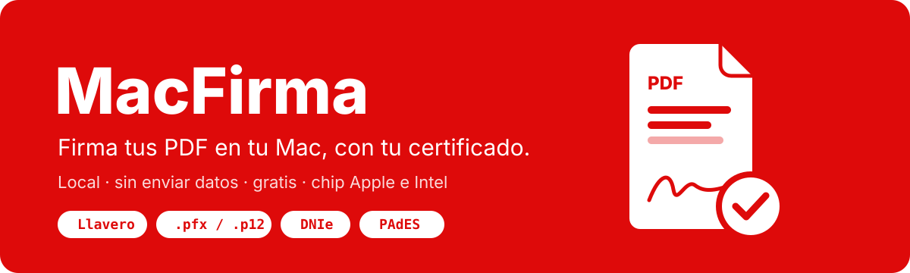

# MacFirma

<p align="center">
  
  
  
  
</p>

<p align="center">
  
</p>

<p align="center">
  <b>Firma tus documentos PDF en tu Mac, con tu propio certificado digital.</b><br>
  Local, sin enviar tus datos a ningún servidor y sin instalar nada más.
</p>

<p align="center">
  <a href="https://github.com/kennedy122112/macfirma-descargas/releases/latest/download/MacFirma-0.5-arm64.dmg"></a>
  <a href="https://github.com/kennedy122112/macfirma-descargas/releases/latest/download/MacFirma-0.5-x86_64.dmg"></a>
</p>

> [!IMPORTANT]
> **Herramienta independiente y no oficial.** MacFirma no es un producto de la PCM, de Firma Perú, de RENIEC ni de
> Apple, ni cuenta con su respaldo, y no es un software de firma acreditado ante INDECOPI. Revisa el
> [aviso legal](#aviso-legal) antes de usarla.

---

## ¿Qué es?


Un firmador de PDF para macOS que produce firmas **PAdES** con el certificado que ya tienes:

| Certificado | Cómo se usa |
|---|---|
| 🔑 **Llavero de macOS** | El certificado instalado en tu Mac; la clave nunca sale del Llavero. |
| 📄 **Archivo .pfx / .p12** | Eliges el archivo y escribes su contraseña. |
| 🪪 **DNIe** | Con un lector de tarjetas USB o USB-C y tu PIN. |

Todo ocurre en tu Mac: el documento, el certificado y el PIN no se envían a ningún lado.

## ¿Cuál descargo?

Menú  › **Acerca de esta Mac**:

| Si dice… | Descarga |
|---|---|
| **Chip** Apple M1, M2, M3, M4… | [MacFirma-0.5-arm64.dmg](https://github.com/kennedy122112/macfirma-descargas/releases/latest/download/MacFirma-0.5-arm64.dmg) |
| **Procesador** Intel | [MacFirma-0.5-x86_64.dmg](https://github.com/kennedy122112/macfirma-descargas/releases/latest/download/MacFirma-0.5-x86_64.dmg) |

Requiere **macOS 11 (Big Sur) o posterior**. Java ya viene dentro de la aplicación. Todas las versiones están en
[Releases](https://github.com/kennedy122112/macfirma-descargas/releases).

## Instalar

```
 Descarga el .dmg ──► arrastra MacFirma a Aplicaciones ──► ábrela ──► «Abrir igualmente» (solo la 1.ª vez)
```

1. Abre el `.dmg` y arrastra **MacFirma** a **Aplicaciones**.
2. Abre MacFirma. La primera vez macOS la bloquea porque no está notarizada por Apple: cierra el aviso.
3. Ve a **Ajustes del Sistema › Privacidad y seguridad**, baja hasta el mensaje sobre MacFirma y pulsa
   **«Abrir igualmente»**. Desde entonces se abre normalmente.

> [!TIP]
> La primera vez que firmes con un certificado del Llavero, macOS pedirá permiso para usar su clave: elige
> **«Permitir siempre»**.

<details>
<summary><b>¿macOS dice que «MacFirma está dañada»?</b></summary>

No lo está: es la marca de cuarentena que macOS pone a los archivos descargados. Quítala en Terminal y vuelve a
abrirla:

```bash
xattr -dr com.apple.quarantine /Applications/MacFirma.app
```

</details>

<details>
<summary><b>Verificar la descarga (SHA-256)</b></summary>

```bash
shasum -a 256 ~/Downloads/MacFirma-0.5-*.dmg
```

| Archivo | SHA-256 |
|---|---|
| MacFirma-0.5-arm64.dmg | `0febe8d02308cda9cda2e5f4f87de8d69d9024c235bf4ea63b26912b666494ed` |
| MacFirma-0.5-x86_64.dmg | `f6295baaf541e34a480eae996f83fecbdbe2bd9c2e46b95918b68617484e47a6` |

</details>

## Privacidad

MacFirma funciona sin conexión a servidores propios: no recopila, almacena ni envía datos personales, documentos,
certificados ni PIN. Las contraseñas y el PIN se escriben solo en la aplicación y no se guardan.

## Aviso legal

- MacFirma se entrega **gratuitamente y «tal cual»**, sin garantías de ningún tipo, expresas o implícitas. El autor no
  es responsable de daños, pérdidas o rechazos derivados de su uso.
- Es una herramienta **independiente y no oficial**. No es un software de firma digital acreditado ante INDECOPI ni
  forma parte de la Infraestructura Oficial de Firma Electrónica (IOFE). Las marcas y nombres de terceros se mencionan
  solo para describir compatibilidad.
- Cada usuario es responsable de los documentos que firma y del uso de su certificado. **Verifica tus documentos
  firmados** en el validador oficial antes de presentarlos; si una entidad exige un software de firma determinado,
  usa el que ella indique.
- Se prohíbe redistribuir versiones modificadas presentándolas como MacFirma.

MacFirma incluye componentes de código abierto de terceros: ver [LICENCIAS-DE-TERCEROS.md](LICENCIAS-DE-TERCEROS.md).

---

<p align="center">© 2026 Brian Steve Kennedy Meneses Morales</p>
